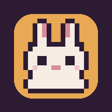
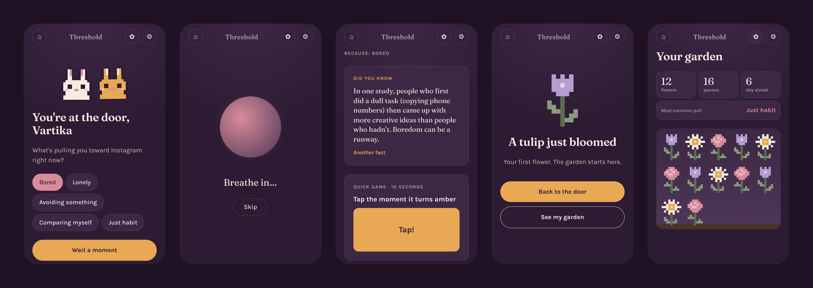

<div align="center">



# Threshold

**A pause before the scroll.**
Open Threshold instead of Instagram, name what's pulling you in, try something tiny, and grow a pixel garden each time you choose something else.

[**Try the live demo →**](https://Vratzz.github.io/threshold/) &nbsp;·&nbsp; [Case study](#case-study) &nbsp;·&nbsp; [Run it locally](#run-it-locally)



</div>

---

## Why this exists

I'd reach for Instagram without deciding to. My thumb knew where the icon was before I'd had a thought. Screen-time limits didn't help, because they kick in *after* the damage, and a blunt "time's up" wall just teaches you to tap "ignore."

I didn't want a blocker. I wanted a **doorway**: a few seconds of friction at the exact moment of the urge, which asks *why* instead of saying *no*.

Threshold is a personal tool and a design experiment. I designed and built it end to end with AI-assisted coding.

---

## Case study

### The problem
Mindless opening of an app is a habit loop: **cue → routine → reward.** The cue is usually an emotion (boredom, loneliness, avoidance) or just context (the icon in the same spot, the same time of night). Most digital-wellbeing tools attack the *routine* with time limits. I wanted to work on the *cue*, because naming a feeling is what makes the choice conscious again.

### Design principles
| Principle | What it means in the product |
|---|---|
| **Ask, don't block** | There's always a no-shame way through. "Still want to open Instagram" is a full-width button, not a hidden link. |
| **Name the pull** | Five reason chips (*Bored, Lonely, Avoiding something, Comparing myself, Just habit*), worded the way you'd say them to a friend, not clinical labels. |
| **Under 30 seconds** | The breathing pause can be skipped, and every activity takes 15 seconds or less. If the pause takes longer than scrolling, people stop using it. |
| **Reward the choice, not the abstinence** | A flower grows when you pick the alternative. Opening the app anyway isn't punished. The pause still counts. |
| **Low stimulation** | Warm plum, amber and cream, a serif display face and slow motion. It's meant to feel like the opposite of a feed. |
| **Private by default** | No accounts and no analytics. Everything lives in `localStorage` on your device. |

### The flow

```
 Onboarding ──► The door ──► Breathe ──► A moment ──► Outcome ──► Garden
 (name +        (2 bunnies    (2 cycles,  (1 fact +    bloom 🌷    (flowers,
  target)        + reasons)    skippable)  1 activity)  or no-shame  pauses,
                                                        exit         streak)
```

**Reason → fact + activity pairing.** Each reason gets 2–3 short, research-backed facts ([sources](docs/research-sources.md)) and one activity that answers *that specific* need:

| Reason | Activity | Why |
|---|---|---|
| Bored | Reaction-time tap game | Boredom wants stimulation, so give it a tiny, finite hit |
| Lonely | Draft a two-line message to a real person | Replaces passive scrolling with active connection |
| Avoiding something | 10 s: say the task and its first step out loud | Naming the first step shrinks the dread |
| Comparing myself | Write one thing you did well today | Your own highlight reel, not someone else's |
| Just habit | 10 s stretch | Breaks the physical autopilot |

### Key design decisions

**Bunnies, not a human avatar.** An early version used a person as the guide, and it felt like being watched or judged. Two pixel bunnies that hop onto the screen feel like company instead. They take the sternness out of a "stop and think" moment.

**A garden instead of a streak counter.** Streaks punish one bad day. A garden only grows. Flowers rotate through tulip, daisy and rose, so the garden looks varied as it fills.

**Pixel art drawn in code.** The bunnies and flowers are character grids rendered to SVG (`src/pixels.js`). They stay crisp at any size, add no image weight, and anyone can edit them in a text editor.

### The constraint that shaped the roadmap
A web app **can't intercept a tap on another app's icon** on iOS. The PWA works when you swap your Instagram icon for Threshold on your home screen, but that relies on willpower at the moment of the urge.

Real interception needs Apple's **Screen Time APIs** (FamilyControls, ManagedSettings and the Shield extensions). So I planned a native iOS version where tapping Instagram shows a Threshold shield first. The full architecture is in [`docs/ios-architecture.md`](docs/ios-architecture.md).

The same constraint applies to reminders. A web page can't wake itself on iOS, so web reminders are best-effort, and the settings screen says so.

### What I'd do next
- Ship the native iOS shield (in progress, see the architecture doc)
- A weekly reflection: *"Most of your pauses were 'Just habit' after 11 pm"*, shown as insight, not judgement
- Run a 2-week diary study with 5–8 people to test whether naming the reason actually changes the outcome

---

## Run it locally

No build step and no dependencies: it's plain HTML, CSS and JavaScript.

```bash
git clone https://github.com/Vratzz/threshold.git
cd threshold
python3 -m http.server 8000   # or: npx serve
```

Open <http://localhost:8000>. The service worker needs `http://` or `https://`, so opening the file directly won't register it, but the app still runs.

**Install it on your phone:** open the live demo in Safari → Share → *Add to Home Screen*. Put it where your Instagram icon used to be.

## Project structure

```
threshold/
├── index.html              # All screens, as <section>s
├── manifest.webmanifest    # PWA metadata
├── sw.js                   # Offline cache + notification taps
├── src/
│   ├── styles.css          # Design tokens + components
│   ├── app.js              # Flow, state, activities, garden, reminders
│   ├── content.js          # Reasons, facts, activity mapping ← edit copy here
│   └── pixels.js           # Pixel-art bunnies & flowers as text grids
├── assets/icons/           # App icons (generated from the bunny grid)
└── docs/
    ├── ios-architecture.md # Native Screen Time version
    ├── research-sources.md # Citations for every fact
    └── screenshots/
```

## Design tokens

| Token | Hex | Use |
|---|---|---|
| `--plum` | `#2D1B33` | Background |
| `--amber` | `#E8A854` | Primary action |
| `--rose` | `#D88C9A` | Selection, warmth |
| `--cream` | `#F5EDE4` | Text |
| `--sage` | `#8A9A7E` | Labels, stems, calm accents |

Type: **Fraunces** (display) and **Karla** (body), both from Google Fonts.

## Accessibility
- Every control is a real `<button>` or `<input>`, reachable by keyboard, with visible focus rings
- Reason chips use `aria-pressed`, and timers and game results announce through `aria-live`
- `prefers-reduced-motion` turns off the hops, blooms and breathing animation
- Text meets WCAG AA contrast on the plum background

## Contributing
Ideas, new activities and better facts are welcome. See [CONTRIBUTING.md](CONTRIBUTING.md).

## License
[MIT](LICENSE) © Vartika Verma

---

<sub>Designed and built by **Vartika Verma**, product designer. Built with AI-assisted coding (Claude), with every design decision mine.</sub>
